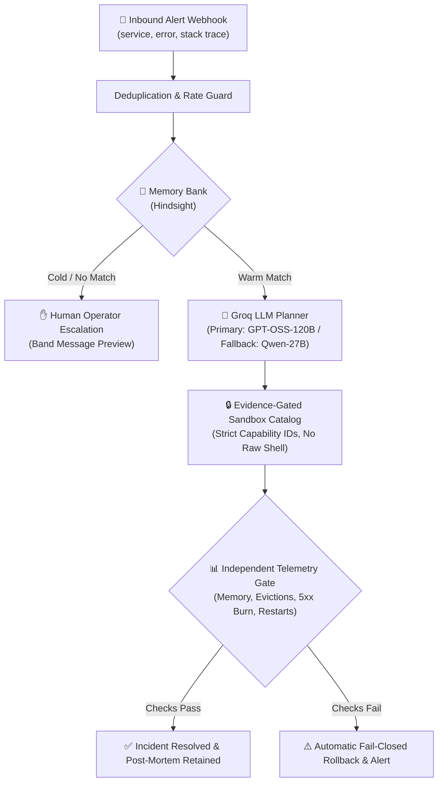

# 🛡️ SRE Incident Agent

[](https://www.python.org/)
[](https://fastapi.tiangolo.com/)
[]()
[]()
[]()

> **Evidence-Gated Autonomous Incident Response with Institutional Memory and Deterministic Verification.**

**SRE Incident Agent** is a full-stack, runnable FastAPI service equipped with **Hindsight** memory (retain/recall/reflect), **Groq** LLM recovery ladders, an evidence-gated action sandbox, independent telemetry gates, and an interactive **Mission Control** web dashboard.

It demonstrates how an autonomous agent resolves high-severity incidents (e.g. `OOMKilled` pod crashloops) by querying past post-mortems, proposing bounded remediation actions, and verifying live metrics before claiming resolution.

**No API keys, Docker, or internet connection are required** to run the complete local demo. A built-in offline simulation mode allows anyone to clone and test it immediately.

---

## 🚀 Quick Start (Under 1 Minute)

### Option A: Using `uv` (Recommended — Fastest)

```bash
# 1. Clone your repository
git clone https://github.com/<your-username>/sre-incident-agent.git
cd sre-incident-agent

# 2. Create virtualenv and install dependencies
uv venv
source .venv/bin/activate
uv pip install -e '.[test]'

# 3. Start the Mission Control server
uvicorn incident_agent.main:app --reload --host 127.0.0.1 --port 8000
```

### Option B: Using standard `python3`

```bash
# 1. Clone your repository
git clone https://github.com/<your-username>/sre-incident-agent.git
cd sre-incident-agent

# 2. Create virtual environment
python3 -m venv .venv
source .venv/bin/activate

# 3. Install dependencies
pip install -e '.[test]'

# 4. Start the server
uvicorn incident_agent.main:app --reload --host 127.0.0.1 --port 8000
```

Now open **http://127.0.0.1:8000** in your browser.

---

## 🖥️ Interactive Mission Control Walkthrough

Once the dashboard is open, execute the 4-stage demo flow:

```
┌──────────────┐     ┌──────────────┐     ┌──────────────┐     ┌──────────────┐
│   1. COLD    │ ──> │   2. SEED    │ ──> │   3. WARM    │ ──> │   4. EVAL    │
│  Alert Fired │     │ Post-Mortems │     │  Retrieved   │     │   10-Turn    │
│  No Past Mem │     │  Populated   │     │ Auto-Remedy  │     │ Learning Rep │
└──────────────┘     └──────────────┘     └──────────────┘     └──────────────┘
```

1. **1. Cold Alert (`INC-4421`)**:
   - Simulates a brand-new alert on `checkout-api` with an empty memory bank.
   - Gathers logs, metrics, and deployment context.
   - Halts and requests human escalation due to lack of verified historical runbooks (projected MTTR: ~42 min).
2. **2. Seed Hindsight Post-Mortems**:
   - Ingests 3 past verified incident post-mortems into the memory bank (including root causes, runbook steps, and expiry metadata).
3. **3. Warm Alert (`INC-4422`)**:
   - The same crashloop alert occurs again.
   - Agent recalls 3 relevant facts from past incident `pm-INC-4401` (reranker score ~0.71).
   - Agent selects verified actions (rollback to `v2.13.7`, flush pricing cache), executes them within the sandbox, and verifies telemetry across 4 independent metric checks (projected MTTR: ~9 min).
4. **4. Run 10-Turn Learning Curve Eval**:
   - Replays 10 incidents across multiple services.
   - Generates the real-time learning curve chart showing MTTR reduction as institutional knowledge compounds.
   - Replay logs are recorded to `data/eval.jsonl`.

---

## 🏗️ Architecture & Safety Boundaries



### Safety & Guardrails
- **Sandbox Boundary**: The action catalog strictly uses pre-approved capability IDs—never raw shell commands. All executions run against an incident simulator; no production infrastructure is touched.
- **Fail-Closed Verification**: Action plans must pass independent checks (pool utilization, 5xx error burn rates, container restarts, memory limits) before claiming resolution.
- **Evidence Provenance**: Memories are checked for validity dates, deprecation status, service/environment match, and verified author tags.

---

## ⚙️ Configuration & Live Integrations (Optional)

To enable live Groq and Hindsight cloud services instead of offline simulation:

1. Copy the example configuration:
   ```bash
   cp .env.example .env
   ```
2. Configure credentials in `.env`:
   ```ini
   # Groq LLM API
   GROQ_API_KEY=gsk_...
   PRIMARY_MODEL=openai/gpt-oss-120b
   FALLBACK_MODEL=qwen/qwen3.8-27b

   # Hindsight Vector Memory
   REMOTE_MEMORY=true
   HINDSIGHT_BASE_URL=https://ui.hindsight.vectorize.io
   HINDSIGHT_API_KEY=...
   BANK_ID=sre-incidents

   # Security Token (leave blank for open local loopback)
   API_TOKEN=
   ```
3. Install live integration dependencies:
   ```bash
   pip install -e '.[live]'
   ```

---

## 📂 Project Structure

```
sre-incident-agent/
├── src/
│   └── incident_agent/
│       ├── main.py                 # FastAPI application factory & lifespan
│       ├── config.py               # Pydantic v2 application settings
│       ├── models.py               # Incident, postmortem, and action schemas
│       ├── state.py                # Process-local memory and demo locks
│       ├── api/
│       │   ├── routes_alert.py     # Webhook alert ingestion & demo triggers
│       │   └── routes_postmortem.py# Post-mortem ingestion and reflection endpoints
│       ├── llm/
│       │   ├── groq_client.py      # Groq model routing with fallback & retry ladder
│       │   ├── tool_loop.py        # Sequential 12-call tool execution ledger
│       │   ├── tools.py            # Diagnostic & remediation tool schemas
│       │   └── prompts.py          # System prompts and repair templates
│       ├── memory/
│       │   ├── hindsight.py        # Hindsight client & local mirror backend
│       │   ├── freshness.py        # Expiration, deprecation, & author checks
│       │   └── schema.py           # Memory document schemas & tag filters
│       ├── execution/
│       │   ├── runbook_runner.py   # Sandbox capability action runner
│       │   ├── verifier.py         # 4-sample independent telemetry gates
│       │   └── policy.py           # Capability authorization rules
│       ├── observability/
│       │   ├── tracing.py          # Prometheus metrics & latency timers
│       │   └── eval_harness.py     # 10-turn learning curve replay harness
│       └── static/
│           ├── index.html          # Mission Control dashboard UI
│           ├── chart.js            # Vendored offline Chart.js
│           └── tailwind.js         # Vendored offline Tailwind compiler
├── fixtures/
│   ├── incidents/incidents.json    # Synthetic alert replay corpus
│   └── postmortems/postmortems.yaml# Seed post-mortems with ground truth
├── tests/
│   ├── test_recall_quality.py      # Hindsight memory retrieval & reranking tests
│   ├── test_stale_runbook.py       # Expiration & deprecation policy tests
│   └── test_tool_recovery.py       # Groq error recovery & schema retry tests
├── docker-compose.yml              # Local container deployment
├── Dockerfile                      # Non-root container image build
├── Makefile                        # Shortcuts for install, test, run, and demo
├── pyproject.toml                  # PEP 621 package metadata & dependencies
└── requirements.txt                # Production requirements
```

---

## 🧪 Testing & Verification

Run the automated test suite:

```bash
# Run pytest with coverage
pytest -v

# Or using Makefile
make test
```

Expected output:
```text
tests/test_recall_quality.py .....                                       [ 31%]
tests/test_stale_runbook.py .....                                        [ 62%]
tests/test_tool_recovery.py ......                                       [100%]
======================== 16 passed in 0.54s =========================
```

---

## 🐳 Docker Deployment

To run via Docker:

```bash
# Build and run the agent container
docker compose up --build
```
Open `http://localhost:8000` in your browser.

---

## 📜 License

This project is licensed under the MIT License. Vendored client libraries ([Chart.js](licenses/Chart.js.txt) and [Tailwind CSS](licenses/Tailwind.txt)) retain their respective open-source licenses in the `licenses/` directory.
